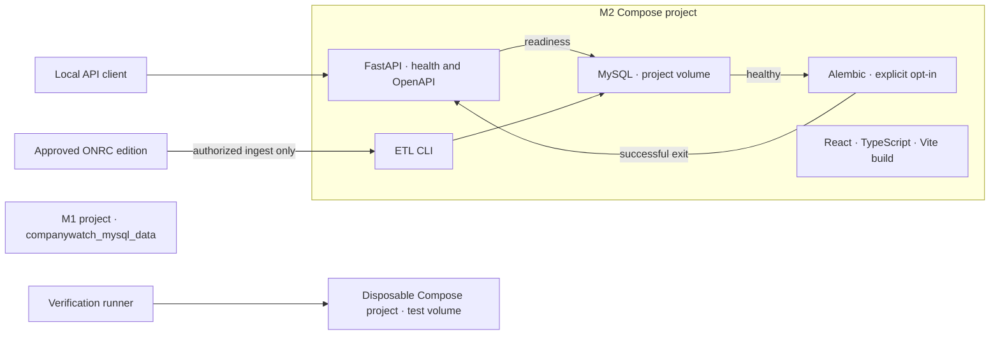
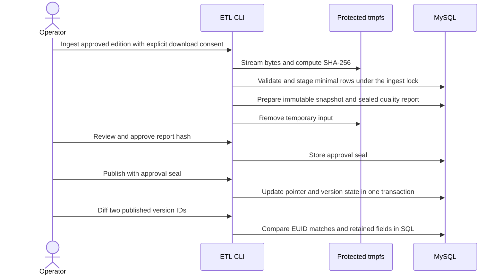

# Architecture — p28-companywatch

<!-- graffino-agentic:begin v1 -->
> How this repo is built, generated from the code at backfill and kept current by
> whoever changes the structure. The code wins: when this page is wrong, fix it.
<!-- graffino-agentic:end -->

## Overview
M1 implements the technical foundation selected in D-003–D-005.
The frontend has build tooling and a React entry rendering null; it has no visual UI.
The backend exposes the health/documentation contract C-001. M2 adds a Docker CLI
and minimal legal-entity ETL snapshots under C-002, with synthetic verification.
Q-004 blocks visual UI; Q-005 blocks publication until complete real validation.

## Parts
| Part | Path | Responsibility | Talks to |
|---|---|---|---|
| API | backend/app/ | FastAPI, configuration, SQL connection and health | MySQL |
| Migrations | backend/migrations/ | Alembic baseline and revision tracking | MySQL |
| ETL | backend/app/etl/ | Temporary download, parse/filter, staged validation, review/approval/publication and SQL diff | MySQL, approved ONRC resources only after explicit consent |
| Database | compose.yaml: db | MySQL with persistent named volume | API and migrations |
| Frontend tooling | frontend/ | React, TypeScript, ESLint and Vite build | No API consumer yet |
| Verification | scripts/verify.py, backend/tests/ | Unit, MySQL and Compose behaviour checks | Isolated Docker project |
| CI | .github/workflows/ci.yml | Same verification on PR and main push | Docker |
| Agent instructions | AGENTS.md | Shared working rules | Knowledge ledger |
| Knowledge ledger | docs/agents/ | Confirmed knowledge and open questions | Agent instructions |
| Design documentation | docs/design/ | Guardrails and future design records | No visual UI yet |
| Claude workflows | .claude/ | Original plan/build skills and agents | Knowledge ledger |

## M1 runtime and M2 components

M1 established the Docker startup order and the FastAPI health routes. Liveness
checks the API process. Readiness queries MySQL and compares the current Alembic
revision with the application's heads. The original M1 revision is
`0001_baseline`; an initialized M2 database uses `0002_etl`. The React entry
point renders no dashboard and does not consume the API.
[Health contract C-001](CONTRACTS.md#c-001--health-and-api-documentation)

## M2 ingest and publication

The publication pointer selects the current snapshot; version IDs allow explicit
historical comparisons. A disappearance is relative to the compared exports.
Real company data has yet to be imported.
[ETL contract C-002](CONTRACTS.md#c-002--etl-snapshots-and-publication-boundary)

## State and storage

| Store | Purpose |
|---|---|
| `etl_versions` and `etl_attempts` | Source identity, lineage, state, quality report, seals and attempt history |
| `etl_staging_rows` | Temporary batches for validation and duplicate detection |
| `company_version_rows` | The eight retained fields in versioned legal-entity snapshots |
| `dataset_publications` | Current snapshot pointer |

The original M1 database uses `companywatch_mysql_data` in project
`companywatch`. The M2 default project uses `companywatch-m2_mysql_data`.
The migration service requires explicit opt-in and rejects the M1 project.
Verification uses a third, disposable project and checks the live MySQL mount
before integration tests and ownership before cleanup.

## Configuration
Non-secret defaults live in `.env.example`. The user explicitly authorized local
MySQL credentials in the Git-ignored, untracked `.env` with mode `600`, generated
once and preserved for existing databases. Exported environment variables remain
an alternative; no credentials belong in versioned files or logs. SQLAlchemy URL objects
handle password encoding; settings representations omit passwords. SQL connection,
read/write and pool acquisition timeouts are finite. API uses a non-root DB user.
MySQL has no host port; API binds to host loopback only. The ETL container mounts a
0700 tmpfs for raw files, limited to 1 GiB; real ingest refuses persistent raw storage.
Raw files are removed on exit and tmpfs is discarded when the container stops.
Only eight legal-entity fields persist; detailed addresses and excluded rows do not.
Source-wide duplicate detection uses temporary keyed digests; their key is never
persisted and staging is erased after processing. Orphan loading versions can be
recovered only while holding the source-content advisory lock. Every ingest
transaction uses the lock-owning session and checks ownership before writing.

## Build, deploy, runtime
All application servers run in Docker (D-001). Backend and frontend base images
are pinned by digest; Python and npm dependencies are locked. The tests and
frontend build are optional Compose tools, not additional public servers.
See ../../README.md for executable commands. CI uses the same verification script.
No deployment or public URL exists; see ../CHECKPOINT.md. No new Python dependency
was introduced for M2: HTTPX, SQLAlchemy and the standard library are reused.

## Boundaries
The API owns C-001 in CONTRACTS.md. Consumers are the Compose healthcheck, tests
and verification script. There are no frontend API consumers or external dataset
HTTP contracts yet. C-002 describes ETL consumers and published-snapshot semantics.
No auth or production deployment architecture is selected. See ../M2-ETL.md.
